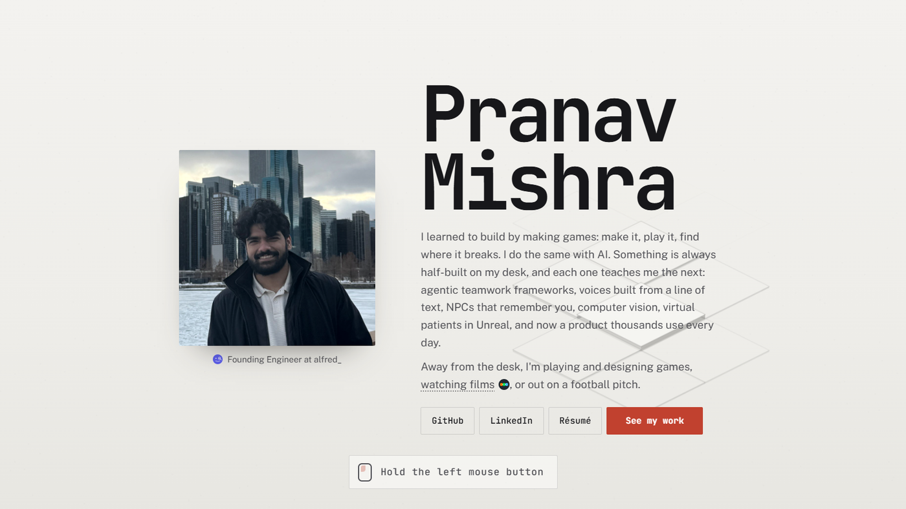
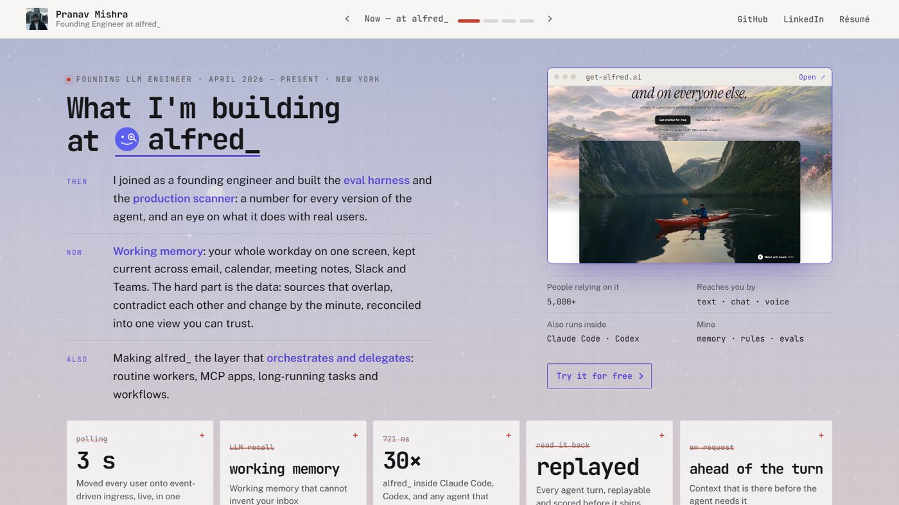
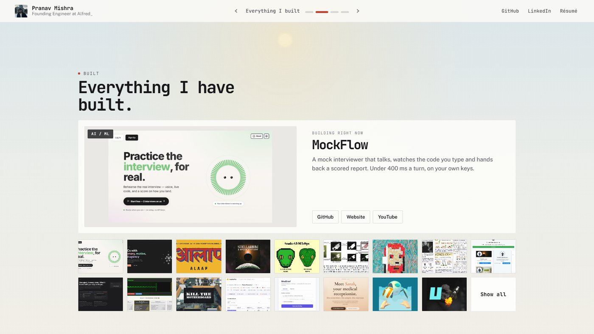
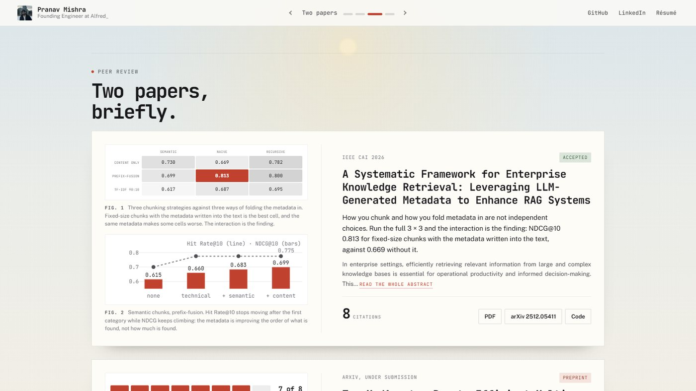
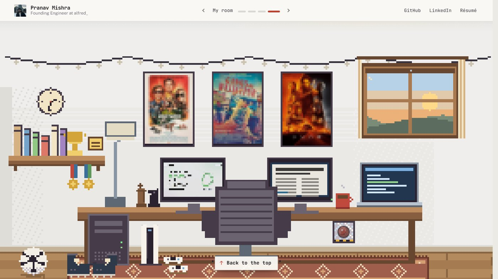
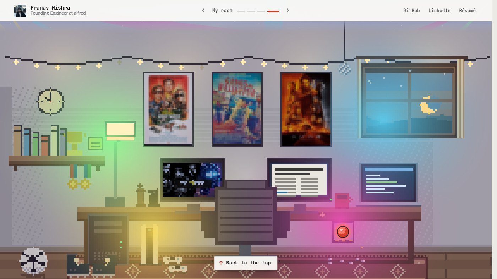
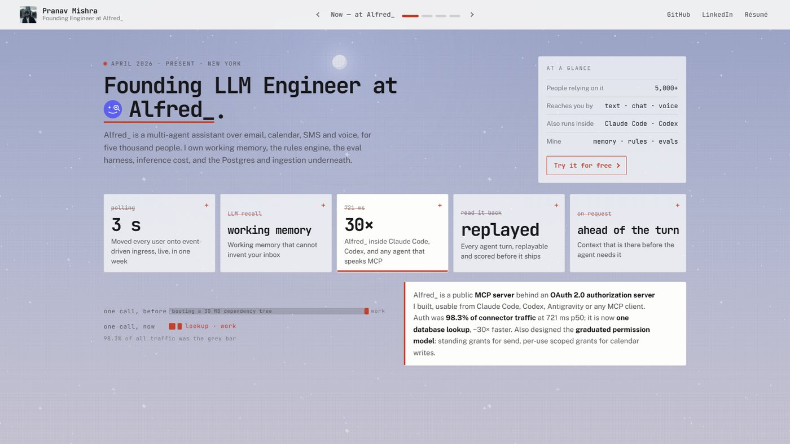
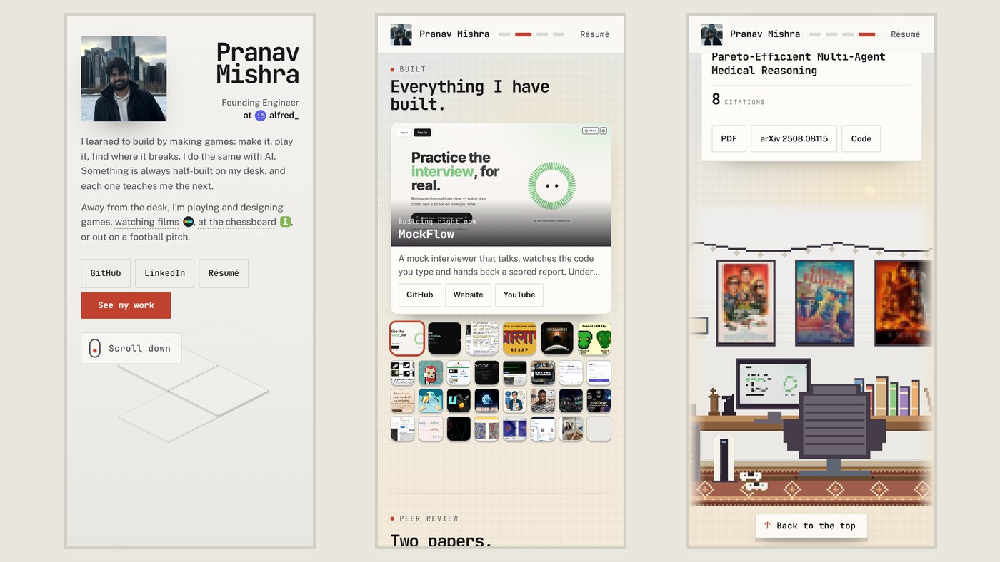

# Portfolio — Pranav Pushkar Mishra

Founding Engineer at alfred\_. One page, no backend: a wall you have to break, what I'm building at alfred\_ in my own words and five measured figures, thirty projects, the papers, and a pixel room at the bottom that keeps real time.

Live at [pranavmishra17.vercel.app](https://pranavmishra17.vercel.app/).



## What's on the page

**The wall.** The site opens on a plaster wall with a short intro on it. Scrolling is the fuse, on any screen: the first part of the scroll lifts the tiles and the intro with them, and past two fifths of a screen the whole thing comes apart and the page is underneath, with the alfred\_ heading in view. Back at the very top the wall drops back in, tile by tile. With a mouse you can also hold the button over it until it goes. See my work does the same from a button; point at it and it says Light the fuse. The words at the end of the intro each do something when you point at them: watching films goes to Letterboxd, the chessboard to chess.com. The face in the header puts the wall back.



**Now.** What I'm building at alfred\_ takes the first screen, in three beats with the key words in alfred\_'s colour. Beside it the alfred\_ site sits in a window: point at it and it scrolls down the real page, and it stays where you leave it. Under that, five figures, each a before struck through and an after that counts up. Point at one and its drawing appears; click and the note stays. Below the fold, WheelPrice as a bar with a car on it (point at the car and it does a two-second lap), and the roles before that, folded.



**Everything I built.** Thirty projects from GitHub, ranked. A viewbox cycles through the ones being built right now; the grid opens each into the frame. SoulEngine's tile is a short silent loop.



**Two papers.** Each with two figures drawn from its results, and a third once the abstract is opened.



**The room.** A 288-pixel-wide room drawn into a palette-index buffer every frame and lit for the hour it actually is: the lamp and string lights come on as it gets dark, the window shows the sun or a crescent moon. Everything in it does something. The books, the games and the posters are real (the covers pixelate onto the wall and clear when you point at them, and the posters lead to Letterboxd); the king and knight on the desk open chess.com; the chair spins; the clock flips the day; the window lets more or less of it in. The party button is in a case on the wall under the desk: the first press breaks the glass, the second starts the disco.



**The sky.** The page's background is a gradient for the hour of the day, drifting about an hour and a half from the top of the page to the bottom. By day a soft sun; by night indigo, stars and a moon on the same arc.



**On a phone.** Laid out for a phone held upright rather than squeezed down from the desk: the wall goes with the scroll (let go early and it springs back), the intro is shorter, the projects are a screen over a keyboard of their pictures, the papers are a title and their links, the figures sit two by two, and the room is tall enough to aim at and swiped along sideways, its notes rising from the bottom.



## How it is built

React 19, react-router 7, react-scripts 5, plain CSS. No TypeScript, no Tailwind, no server. Fonts from Google Fonts; everything else is in the repo.

- `src/variants/v19/` is the site. `index.js` is the page shell; `copy.js` rewrites the content in `src/data/` at render time (one-liners, renames, the Alfred\_ figures, the paper overrides); `personal.js` is the shelf — books, games, posters, trophies.
- `wall/` is the wall: `iso2.js` cuts the isometric tiles into a sprite atlas once and blits them; `Wall.js` owns the physics of the collapse; `index.js` runs the one loop. A frame identical to the last one is not drawn, so a wall nobody is touching costs nothing. The blast is two phases: only the canvas changes when it goes off, and the page underneath wakes once the tiles have cleared, so nothing repaints under them while they fly.
- `room/` is the room: `engine.js` is the pixel engine (palette indices with day and night values, lights that pull colour back toward day, a hover outline for free), `scene.js` draws it, `Room.js` runs it and handles what you click. The still parts are drawn once and copied in each frame; the room does not draw at all when it is off screen.
- The classic site that came before is kept at [`/classic`](https://pranavmishra17.vercel.app/classic), loaded only if asked for. Prompt Patrol, the LLM-themed shooter, lives there; its design doc is [docs/prompt-patrol-gdd.html](./docs/prompt-patrol-gdd.html).

```
portfolio/
├── public/
│   ├── assets/images/
│   │   ├── web/                     # web-sized project pictures (the ones the site uses)
│   │   ├── room/                    # covers and posters, pixelated onto the room
│   │   ├── companies/               # logos
│   │   └── {ai_ml,game_design,misc}/  # the originals
│   ├── llms.txt
│   └── resumes/{ai,game}/           # local backup of the résumé PDF
├── scripts/
│   ├── stress.js                    # performance and stress harness (see below)
│   ├── blast.js                     # frame timing across the wall's collapse only
│   ├── scroll-jank.js               # a phone scrolled up and down, through the wall and back
│   └── generate-resume-manifest.js
└── src/
    ├── App.js                       # "/" and "/resume" are v19; "/classic" is the old site
    ├── data/                        # projects.js, experience.js, publications.js,
    │                                # projectsGithub.js, projectImagesWeb.js
    ├── variants/v19/                # the site
    │   ├── index.js  copy.js  personal.js  hooks.js  v19.css  Resume.js
    │   ├── sections/                # Landing, Work, Projects, Papers
    │   ├── wall/                    # Wall.js, iso2.js, index.js
    │   └── room/                    # engine.js, scene.js, Room.js
    ├── MainPortfolio.js             # the classic page
    └── components/                  # the classic page's parts, and Prompt Patrol
```

The "where do I edit X" map for the classic page is in [CLAUDE.md](./CLAUDE.md).

## Quick start

```bash
cd portfolio
npm install
npm start                         # http://localhost:3000
```

| script | what it does |
|---|---|
| `npm run build` | Production build. Bash sets `CI=false`; on Windows CMD use `set CI=false && npx react-scripts build`. |
| `node scripts/stress.js <url> [dpr] [--quick]` | Loads the page in a real Chromium and reports fps, animation loops per frame, JS time per frame, long frames, heap, nodes and listeners across a set of scenes: idle on the wall, a stalled main thread, twenty seconds in a background tab, a resize storm, the blast, the room, three rebuild-and-blast cycles and a soak. Needs `playwright-core` and a Chromium. |
| `node scripts/scroll-jank.js <url> [cpu-slowdown] [--hide=<selectors>]` | A 390 × 844 touch screen, the CPU slowed to a phone's, finger-dragged through the wall, down the page, up it and back to the top, three times. Per stretch: the median and 95th percentile frame, frames past 33 ms, frames that moved against the scroll, and the scripts behind the longest frames. `--hide` takes parts of the page out to find which one the frames go to. |
| `node scripts/blast.js <url> [dpr]` | Holds the wall until it goes, then times every frame of the collapse at 1x and 4x CPU throttle: median, 95th percentile, worst frame and frames over 25 ms. The worst frame should stay near 17 ms. Point `PLAYWRIGHT_CORE` at a `playwright-core` directory. |
| `npm run resume-manifest` | Scans `public/resumes/{ai,game}/` and writes `manifest.json`. Runs on `prestart` and `prebuild`. |
| `npm test` | Jest via react-scripts. |

## Changing the content

| To change... | Edit |
|---|---|
| A project's one-liner, name or repo link | `src/variants/v19/copy.js` — `LINE`, `RENAME`, `REPO` |
| Which projects show, and in what order | `KEEP` in `copy.js` |
| A project's picture | drop a web-sized copy in `public/assets/images/web/` under a new name and point `src/data/projectImagesWeb.js` at it (the old name stays cached for a week) |
| A project not in `projects.js` | `src/data/projectsGithub.js` |
| The Alfred\_ figures and notes, WheelPrice, the roles | `ALFRED`, `FIGURES`, `WHEELPRICE`, `AFTER_LINE` in `copy.js` |
| Books, games, posters, trophies | `src/variants/v19/personal.js` + the pictures in `public/assets/images/room/` |
| The papers' figures | `FIGURES` in `src/variants/v19/sections/Papers.js` |
| The résumé | the live PDF is in `PranavMishra17/PranavMishra17`; any `.pdf` in `public/resumes/ai/` is the fallback |

Project pictures are cached for a week (`vercel.json`), so a replaced picture needs a new filename.

## Performance

The wall and the room each run one animation loop with exactly one frame pending at a time; nothing runs while the tab is hidden or the section is off screen, and CSS animations are paused under the wall and outside the viewport. `scripts/stress.js` is how that is checked: on the wall, loops per frame must read 1 and JS per frame under 0.1 ms; after the blast, with the room off screen, 0.

## Deployment

Vercel, from `portfolio/` ([vercel.json](./portfolio/vercel.json)). Pushing `main` deploys. Pictures under `/assets/` are cached for a week; the built JS for a year.

## License

MIT — see [LICENSE](./LICENSE).

## Contact

Pranav Pushkar Mishra · [pmishr23@uic.edu](mailto:pmishr23@uic.edu) · [LinkedIn](https://www.linkedin.com/in/pranavgamedev/) · [GitHub](https://github.com/PranavMishra17) · [YouTube](https://www.youtube.com/@parano1dgames)
